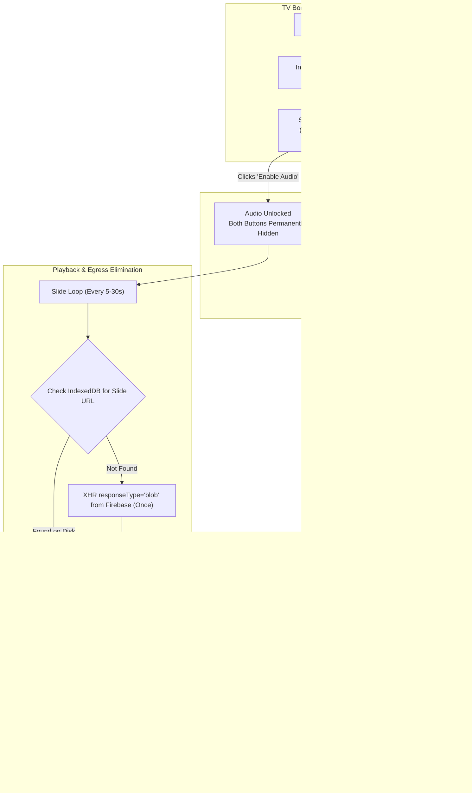

# PanelSync Classic: Legacy Smart TV (Chrome ≤ 77/80) Egress & Cache Plan

## 1. Context & Legacy Smart TV Challenges

Operating digital signage on older Smart TVs (manufactured circa 2015–2020 running **Chromium 53–79 / webOS 3.x–4.5 / Tizen 3.0–5.0**) introduces four critical constraints that break modern web techniques:

```
┌────────────────────────────────────────────────────────────────────────────────────────┐
│                        LEGACY SMART TV TECHNICAL BOUNDARIES                           │
├───────────────────────────┬────────────────────────────────────────────────────────────┤
│ Constraint                │ Impact on Modern Features                                  │
├───────────────────────────┼────────────────────────────────────────────────────────────┤
│ 1. JavaScript Engine      │ STRICT ES5 ONLY. No `async/await`, `const/let`, arrow      │
│    (Chrome < 80)          │ functions, or template literals. Code will syntax error.   │
├───────────────────────────┼────────────────────────────────────────────────────────────┤
│ 2. Unsecured HTTP Origin  │ College displays hosted on LAN IPs (`http://192.168.x.x`)   │
│    (No HTTPS)             │ strictly DISABLE `CacheStorage` & Service Workers!         │
├───────────────────────────┼────────────────────────────────────────────────────────────┤
│ 3. Severe RAM Budget      │ Typical TV has only 1–1.5 GB RAM (browser heap ~250 MB).    │
│    (Low Memory / OOM)     │ Holding 20 images + 2 videos in RAM simultaneously causes  │
│                           │ the TV browser to crash or display a blank white screen.   │
├───────────────────────────┼────────────────────────────────────────────────────────────┤
│ 4. Remote / D-Pad Nav     │ Buttons must support D-pad navigation (`tabindex`, focus   │
│                           │ outlines) and remote click events.                         │
└───────────────────────────┴────────────────────────────────────────────────────────────┘
```

---

## 2. Updated Architecture: IndexedDB + Dynamic Memory Cycling

Instead of the modern `CacheStorage` API (which fails on `http://` and older TV engines), we use **`IndexedDB` with `XMLHttpRequest Level 2` Blobs**.



### Why IndexedDB is the Right Fit for Chrome ≤ 77/80:
1. **Works on HTTP & LAN**: Does not require HTTPS or secure context. Works directly on college intranet IPs (`http://192.168...`).
2. **Universal Compatibility**: Supported across Chrome 38+, webOS 2.0+, Tizen 3.0+.
3. **True Local Disk Persistence**: Blobs are saved to the TV's internal flash storage, not held in volatile RAM.
4. **OOM Crash Prevention**: Blobs stay stored on disk. We only create a `blob:` URL for the *currently active slide*, and immediately call `URL.revokeObjectURL()` when the slide ends. This guarantees memory usage never climbs regardless of how many hours the TV runs!

---

## 3. Financial & Bandwidth Impact

| Metric | Current Implementation | IndexedDB TV Cache | Savings |
| :--- | :--- | :--- | :--- |
| **Daily Media Egress** | **17.2 GB to 25.9 GB / day** | **~0.10 GB** (initial boot only) | **-99.5%** |
| **Weekly Egress (5 days)** | **86.1 GB / week** | **~0.10 GB / week** | **-99.8%** |
| **Monthly Egress (20 days)** | **344.4 GB / month** | **< 0.5 GB / month** | **-99.8%** |
| **Firebase Cloud Billing** | ~$41.30 / screen / month | **$0.00** (Free quota is 1GB/day) | **100% saved** |

---

## 4. UI / UX Design: The Dual-Button TV Control Bar

Per your requirement:
1. **Side-by-side buttons**:
   - `[ 🔊 Enable Audio ]` (primary color `#4f46e5`)
   - `[ 🗑️ Expire Cache ]` (slate pill button `#334155`)
   - Subtitle text `#cacheStatusMsg` displaying cache state (e.g., *"Cache: Ready"* or *"Cache cleared: Re-downloading 3/22..."*).
2. **Auto-Hide Behavior**:
   - When **"Enable Audio"** is clicked:
     - Sets audio unlocked.
     - Entire control bar container is hidden (`style.display = 'none'`).
     - **Both buttons stay completely hidden** during all slide transitions.
     - **To see the buttons again, the user must manually reload the page (`F5` or browser refresh).**
3. **"Expire Cache" Behavior**:
   - When clicked:
     - Clears the IndexedDB store.
     - Revokes any currently held blob URLs.
     - Triggers a fresh download of all media assets from Firebase Storage into IndexedDB.
     - Shows live download progress on screen.
     - Keeps the buttons visible so the operator can then click "Enable Audio" when ready.

---

## 5. Exact Implementation in `display.html` (Strict ES5)

### A. CSS Styles (TV-Optimized with D-Pad Focus Support)

```css
/* TV Operator Control Bar */
#startupControlBar {
  position: fixed;
  top: 50%;
  left: 50%;
  -webkit-transform: translate(-50%, -50%);
  transform: translate(-50%, -50%);
  z-index: 10001;
  display: block;
  background: rgba(15, 23, 42, 0.92);
  border: 2px solid rgba(255, 255, 255, 0.2);
  border-radius: 16px;
  padding: 24px 32px;
  text-align: center;
  box-shadow: 0 10px 30px rgba(0, 0, 0, 0.8);
  font-family: sans-serif;
}

.control-btn-row {
  display: flex;
  justify-content: center;
  gap: 16px;
  margin-bottom: 12px;
}

#audioUnlockBtn {
  background: #4f46e5;
  color: #ffffff;
  border: 2px solid transparent;
  border-radius: 10px;
  padding: 14px 24px;
  font-size: 1.25rem;
  font-weight: bold;
  cursor: pointer;
  outline: none;
}

#audioUnlockBtn:focus, #audioUnlockBtn:hover {
  background: #4338ca;
  border-color: #ffffff;
}

#expireCacheBtn {
  background: #334155;
  color: #f8fafc;
  border: 2px solid transparent;
  border-radius: 10px;
  padding: 14px 20px;
  font-size: 1.25rem;
  font-weight: 600;
  cursor: pointer;
  outline: none;
}

#expireCacheBtn:focus, #expireCacheBtn:hover {
  background: #475569;
  border-color: #ffffff;
}

#cacheStatusMsg {
  color: #94a3b8;
  font-size: 0.95rem;
  margin-top: 8px;
  min-height: 1.2rem;
}
```

### B. HTML Structure (Replacing Old `#audioUnlockBtn`)

```html
<!-- Operator Control Bar -->
<div id="startupControlBar">
  <div class="control-btn-row">
    <button id="audioUnlockBtn" onclick="unlockAudio()" tabindex="1">🔊 Enable Audio</button>
    <button id="expireCacheBtn" onclick="expireCache()" tabindex="2">🗑️ Expire Cache</button>
  </div>
  <div id="cacheStatusMsg">Ready. Click 'Enable Audio' to begin.</div>
</div>
```

### C. JavaScript Engine (Strict ES5 IndexedDB Engine)

```javascript
// ==========================================
// LEGACY SMART TV INDEXEDDB CACHE (ES5)
// ==========================================
var DB_NAME = 'PanelSyncClassicTVCache';
var DB_VERSION = 1;
var STORE_NAME = 'media_blobs';
var idb = null;
var activeSlideBlobUrl = null;

function initIndexedDB(callback) {
  if (!window.indexedDB) {
    if (callback) callback(false);
    return;
  }
  try {
    var req = window.indexedDB.open(DB_NAME, DB_VERSION);
    req.onupgradeneeded = function (e) {
      var db = e.target.result;
      if (!db.objectStoreNames.contains(STORE_NAME)) {
        db.createObjectStore(STORE_NAME);
      }
    };
    req.onsuccess = function (e) {
      idb = e.target.result;
      if (callback) callback(true);
    };
    req.onerror = function (e) {
      console.warn("IndexedDB error:", e);
      if (callback) callback(false);
    };
  } catch (err) {
    console.warn("IndexedDB init exception:", err);
    if (callback) callback(false);
  }
}

// Download asset via XHR Level 2 (Supported since Chrome 19)
function downloadBlobXHR(url, onSuccess, onError) {
  var xhr = new XMLHttpRequest();
  xhr.open('GET', url, true);
  xhr.responseType = 'blob';
  xhr.onload = function () {
    if (xhr.status === 200 || xhr.status === 206) {
      onSuccess(xhr.response);
    } else {
      if (onError) onError(new Error("HTTP status " + xhr.status));
    }
  };
  xhr.onerror = function (err) {
    if (onError) onError(err);
  };
  xhr.send();
}

// Get playable URL from IndexedDB (or download once)
function getPlayableMediaUrl(url, callback) {
  if (!url) {
    callback(url);
    return;
  }
  if (!idb) {
    // If TV does not support IndexedDB, fallback directly to remote URL
    callback(url);
    return;
  }

  try {
    var tx = idb.transaction(STORE_NAME, 'readonly');
    var store = tx.objectStore(STORE_NAME);
    var getReq = store.get(url);

    getReq.onsuccess = function (e) {
      var blob = e.target.result;
      if (blob) {
        // Cache Hit: Generate blob URL from local storage
        var blobUrl = URL.createObjectURL(blob);
        callback(blobUrl);
      } else {
        // Cache Miss: Download once and store in IndexedDB
        downloadBlobXHR(url, function (downloadedBlob) {
          try {
            var writeTx = idb.transaction(STORE_NAME, 'readwrite');
            var writeStore = writeTx.objectStore(STORE_NAME);
            writeStore.put(downloadedBlob, url);
          } catch (we) {
            console.warn("Error caching blob to IDB:", we);
          }
          var freshBlobUrl = URL.createObjectURL(downloadedBlob);
          callback(freshBlobUrl);
        }, function (err) {
          console.warn("Blob download failed, using raw URL:", err);
          callback(url);
        });
      }
    };
    getReq.onerror = function () {
      callback(url);
    };
  } catch (ex) {
    callback(url);
  }
}

// Expire Cache Button Action
function expireCache() {
  var statusEl = document.getElementById('cacheStatusMsg');
  if (statusEl) statusEl.textContent = 'Purging cache from TV storage...';

  if (activeSlideBlobUrl) {
    URL.revokeObjectURL(activeSlideBlobUrl);
    activeSlideBlobUrl = null;
  }

  if (idb) {
    try {
      var tx = idb.transaction(STORE_NAME, 'readwrite');
      var store = tx.objectStore(STORE_NAME);
      var clearReq = store.clear();
      clearReq.onsuccess = function () {
        if (statusEl) statusEl.textContent = 'Cache purged! Re-downloading fresh media...';
        preloadAllMedia();
      };
      clearReq.onerror = function () {
        if (statusEl) statusEl.textContent = 'Failed to purge cache.';
      };
    } catch (e) {
      if (statusEl) statusEl.textContent = 'Error clearing cache.';
    }
  } else {
    if (statusEl) statusEl.textContent = 'No local cache found. Re-syncing...';
    fetchMedia();
  }
}

// Preload & Cache All Media Items with Progress
function preloadAllMedia() {
  var statusEl = document.getElementById('cacheStatusMsg');
  if (!mediaArray || mediaArray.length === 0) return;

  var completed = 0;
  var total = mediaArray.length;

  for (var i = 0; i < mediaArray.length; i++) {
    (function (item) {
      if (item.url) {
        getPlayableMediaUrl(item.url, function (blobUrl) {
          // Immediately revoke during pre-caching so RAM is not consumed
          if (blobUrl && blobUrl.indexOf('blob:') === 0) {
            URL.revokeObjectURL(blobUrl);
          }
          completed++;
          if (statusEl) {
            statusEl.textContent = 'Caching media: ' + completed + ' of ' + total + ' complete';
          }
          if (completed >= total) {
            if (statusEl) statusEl.textContent = 'All assets cached! Click "Enable Audio" to run.';
          }
        });
      }
    })(mediaArray[i]);
  }
}

// Enable Audio Action
function unlockAudio() {
  audioUnlocked = true;

  // HIDE BOTH BUTTONS COMPLETELY (User requirement)
  var controlBar = document.getElementById('startupControlBar');
  if (controlBar) {
    controlBar.style.display = 'none';
  }

  var activeLayerObj = getLayer(activeLayer);
  if (activeLayerObj.vidEl && activeLayerObj.vidEl.classList.contains('active')) {
    activeLayerObj.vidEl.muted = false;
  }

  if (!audioElement) {
    audioElement = document.getElementById('backgroundAudio');
  }

  if (audioElement && audioElement.src) {
    var playPromise = audioElement.play();
    if (playPromise !== undefined) {
      playPromise.catch(function (e) { console.warn("Audio play failed:", e); });
    }
  }
}
```

### D. Slide Teardown: TV OOM Crash Prevention
In `startSlide(...)` and `setupLayer(...)`:
When a slide finishes, revoke the previous blob URL:
```javascript
// Cleanup previous slide's blob URL from memory
if (activeSlideBlobUrl) {
  URL.revokeObjectURL(activeSlideBlobUrl);
  activeSlideBlobUrl = null;
}
activeSlideBlobUrl = currentPlayableUrl;
```
This guarantees that only **1 slide's media resides in RAM at any given time**, completely avoiding TV crashes or browser reboots.

---

## 6. Implementation Plan Review & Next Step

The architecture now complies with:
- [x] **Chrome ≤ 77/80 & ES5 Only**: 100% pure ES5 (`var`, `XMLHttpRequest`, closures, callbacks).
- [x] **HTTP / LAN Friendly**: Works on internal college IPs (`http://192.168.x.x`).
- [x] **OOM Safe for 10-Hour Runs**: Only 1 Blob in RAM at a time; all assets stored on TV flash storage via IndexedDB.
- [x] **Dual Control Bar**: "Enable Audio" + "Expire Cache" displayed side-by-side on boot, hidden permanently upon clicking "Enable Audio" until manual reload.

Please approve this updated plan to apply the changes to [display.html](file:///d:/Git/panelsync-classic/display.html).
